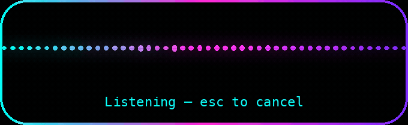
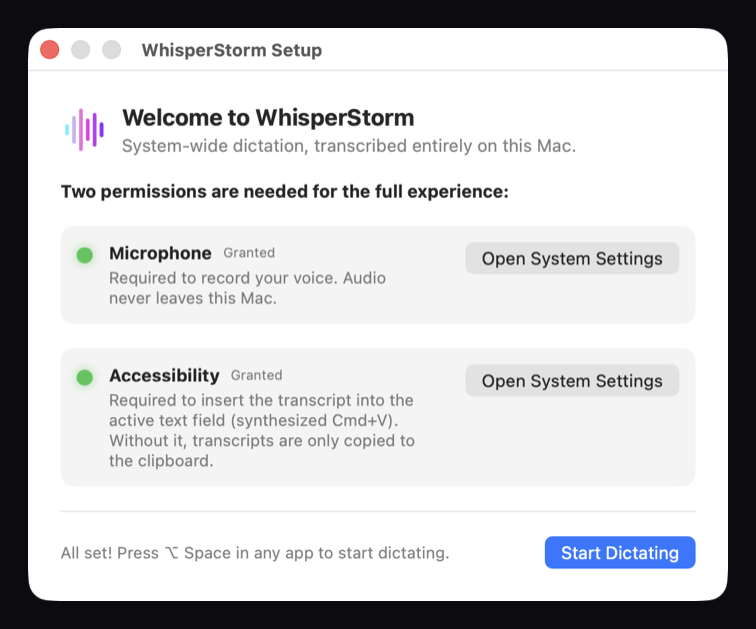
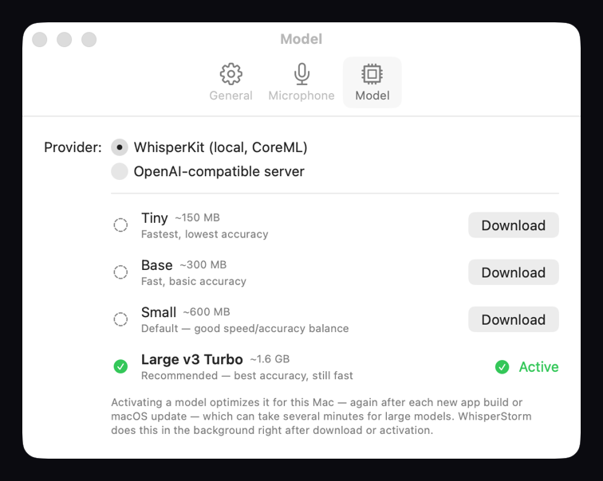
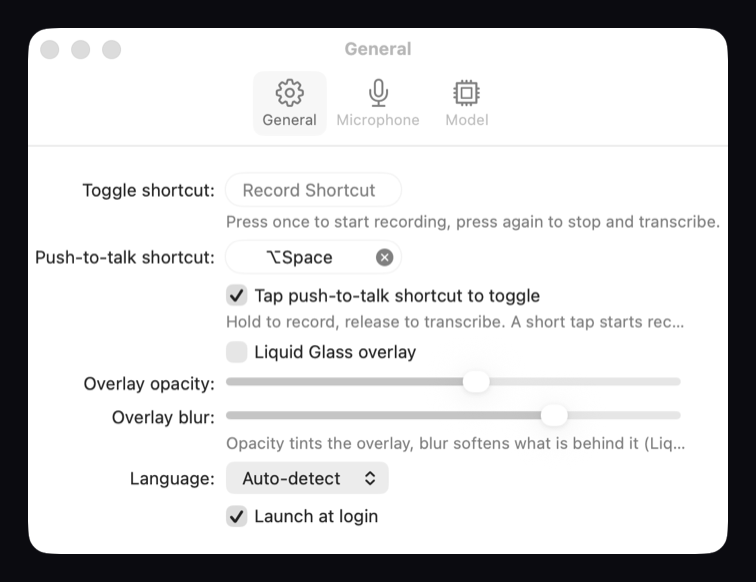

# WhisperStorm

**System-wide dictation for macOS. Press a hotkey, speak, and the text lands in whatever app you're working in — transcribed entirely on your Mac.**

WhisperStorm is a native menu-bar app. No cloud, no account, no telemetry: audio never leaves your machine.

<p align="center">
  
</p>

## Features

- **Global hotkey** — toggle (press, speak, press) or push-to-talk (hold, speak, release). Default ⌥ Space.
- **100 % on-device** — [WhisperKit](https://github.com/argmaxinc/argmax-oss-swift) on CoreML / Apple Silicon, or any OpenAI-compatible local server.
- **German and English** — auto-detect or fixed.
- **Pastes where you type** — result goes to the clipboard and into the focused text field.
- **Live waveform overlay** — non-activating, never steals focus from your app.
- **Microphone picker**, launch at login, Esc to cancel.

## Requirements

- macOS 14+, Apple Silicon
- Xcode 16+ and [XcodeGen](https://github.com/yonaskolb/XcodeGen) (`brew install xcodegen`)

WhisperStorm is not notarized, so you build it yourself.

## Install

```bash
git clone https://github.com/hpmartini/WhisperStorm.git
cd WhisperStorm

# Once per machine: stable signing identity so macOS keeps your permissions across rebuilds
./scripts/setup-signing.sh

xcodegen generate && xcodebuild -project WhisperStorm.xcodeproj -scheme WhisperStorm -configuration Release -derivedDataPath build build && open build/Build/Products/Release/WhisperStorm.app
```

A waveform icon appears in the menu bar. Copy the app to `/Applications` if you want Launch at Login.

> Skipping `setup-signing.sh` falls back to ad-hoc signing; macOS then resets the Accessibility permission on every rebuild and text only reaches the clipboard. See [Why signing matters](#why-signing-matters).

## First run

The Setup Assistant opens on first launch (reopen it via menu-bar icon → *Setup Assistant…*).

<p align="center">
  
</p>

1. **Microphone** — required to record.
2. **Accessibility** — required to paste into the focused field. Without it, transcripts are only copied to the clipboard.
3. **Notifications** (optional) — error messages and the "Copied to clipboard" fallback.

Then pick a model: menu-bar icon → *Settings…* → **Model**.

<p align="center">
  
</p>

| Model | Size | Notes |
|:------|:-----|:------|
| Tiny | ~150 MB | Fastest, lowest accuracy |
| Base | ~300 MB | Fast, basic accuracy |
| Small | ~600 MB | Default — good balance |
| Large v3 Turbo | ~1.6 GB | **Recommended** — best accuracy, still fast |

Models live in `~/Library/Application Support/WhisperStorm/models`. After a download CoreML compiles the model for your chip once (up to several minutes for Large v3 Turbo); until then the overlay shows "Preparing model…". The tokenizer is fetched once, which needs a network connection.

## Usage

- **Toggle** (default **⌥ Space**): press to record, press again to stop and transcribe.
- **Push to talk** (unbound by default): hold while speaking, release to transcribe. With *Tap push-to-talk shortcut to toggle*, a short tap (< 0.3 s) starts recording and the next tap stops it.
- **Esc** while recording cancels — nothing is inserted, the clipboard is untouched.
- The text stays on the clipboard after pasting. If nothing has keyboard focus you get a "Copied to clipboard" notification.

Both shortcuts, language, overlay look and launch at login are in Settings → **General**.

<p align="center">
  
</p>

### Using a local server instead of WhisperKit

Settings → Model → Provider: *OpenAI-compatible server*. WhisperStorm POSTs WAV audio to `<base URL>/v1/audio/transcriptions`, so any OpenAI-compatible STT server works — for example a [speaches](https://github.com/speaches-ai/speaches) (faster-whisper) container:

```bash
docker run --rm -p 8000:8000 ghcr.io/speaches-ai/speaches:latest-cpu
```

- **Server base URL**: `http://localhost:8000`
- **Model name**: `Systran/faster-whisper-small` (downloaded by the server on first use)

> Docker Model Runner currently serves LLMs only and has no speech-to-text endpoint. Once it does, point the base URL at it — the same provider works unchanged.

## Why signing matters

Pasting (a synthesized Cmd+V) needs the **Accessibility** permission, and macOS ties that permission to the app's **code signature**. Ad-hoc signing produces a new signature every build, silently invalidating the grant. `scripts/setup-signing.sh` creates a stable self-signed identity (`WhisperStorm Dev`) that `project.yml` uses for every build, so the grant persists.

After the first signed build: trigger a dictation, then enable *WhisperStorm* in System Settings → Privacy & Security → **Accessibility** (and confirm the **Microphone** prompt). From then on rebuilds keep the permission. If insertion fails, WhisperStorm notifies you and logs the reason to `~/Library/Logs/WhisperStorm.log`.

> Coming from an ad-hoc build? Reset the stale entry with `tccutil reset Accessibility de.martinilabs.WhisperStorm`, then re-grant.

## Troubleshooting and limitations

- **Text only in the clipboard** — Accessibility not granted (or stale after a signing change), a secure input field (password fields, terminals with Secure Keyboard Entry) is focused, or nothing has focus.
- **Launch at Login fails** — copy the app to `/Applications`.
- **First transcription after switching models is slow** — one-time CoreML specialization.
- No streaming insertion and no punctuation/LLM post-processing (by design).
- Whisper models occasionally hallucinate short filler phrases on silent recordings.

## Documentation

- [SPEC.md](SPEC.md) — product spec, architecture, acceptance criteria, macOS constraints
- [CLAUDE.md](CLAUDE.md) — guidance for AI coding agents working in this repo
- [TASK.md](TASK.md) — issue log with root causes

## Contributing

Issues and pull requests are welcome. There is no test target; verify changes by building and dictating once. `WhisperStorm.xcodeproj` is generated — edit `project.yml`, not the project.

## License

[MIT](LICENSE). Dependencies keep their own licenses ([WhisperKit](https://github.com/argmaxinc/argmax-oss-swift), [KeyboardShortcuts](https://github.com/sindresorhus/KeyboardShortcuts), both MIT). Whisper model weights are subject to their own licenses.
